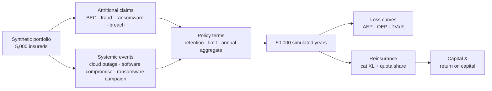
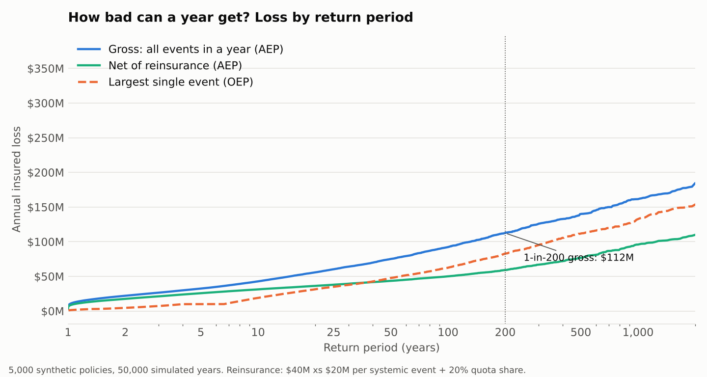
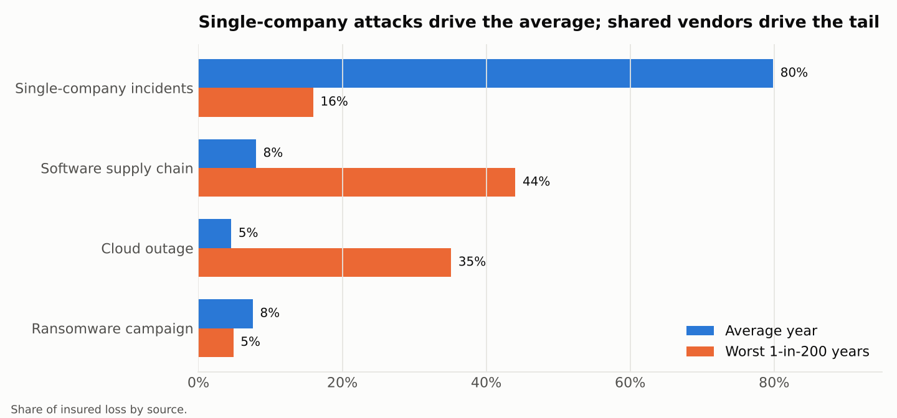
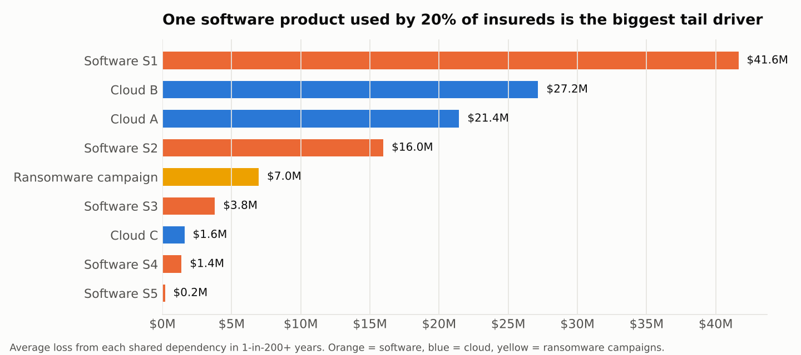
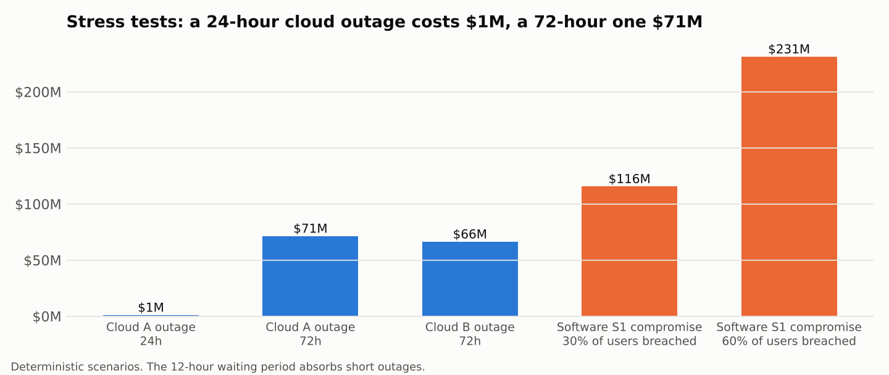
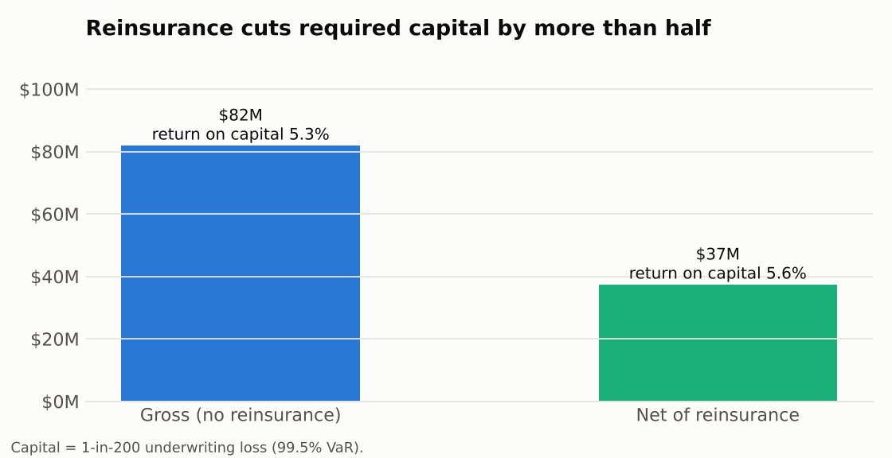

<div align="center">

# 🌐 Cyber Catastrophe Accumulation Model

**How much can a cyber insurance book lose in one bad year, what drives that tail, and how much reinsurance and capital does it need?**


</div>

---

## 📌 At a glance

| | |
|:--|:--|
| **Average annual loss** | **$26.2M** on $43.7M of premium |
| **1-in-200-year loss** | **$112M**: 2.6× premium |
| **Tail driven by shared vendors** | **~80%** of loss in the worst years |
| **Capital with reinsurance** | **$82M → $37M** at a similar return on capital |

> [!IMPORTANT]
> **The headline finding:** security controls lower the *average* loss by 16% but the *1-in-200* loss by only about 6%. Controls are a pricing tool; the tail is managed with vendor limits, policy wording and reinsurance.

---

## 🧭 How the model works



Each insured has an industry, revenue, policy limit and retention, a mix of security controls (MFA, EDR, backups, patching), a cloud provider, and a set of software products. Every simulated year draws:

- **Single-company claims** from a Poisson process, with sizes that scale with company size, industry and controls
- **Cloud outages** that pay business interruption past a 12-hour waiting period for every dependent insured
- **Software supply-chain compromises** that breach a random share of a product's users
- **Mass ransomware campaigns** that hit unpatched firms four times as often

---

## 📈 Results

### How bad can a year get?


The **AEP** curve (blue) is the total loss in a year; the **OEP** curve (orange) is the single largest event. The gap between them is many smaller events piling up. Reinsurance (green) flattens the tail.

| Return period | All events in a year (AEP) | Largest single event (OEP) | Loss ÷ premium |
|:--|--:|--:|--:|
| 1-in-10 | $43M | $19M | 98% |
| 1-in-100 | $92M | $62M | 211% |
| 1-in-200 | $112M | $83M | 257% |
| 1-in-500 | $140M | $112M | 320% |

### What drives the average vs the tail


### Which shared dependency matters most


> [!TIP]
> The most widely used software product (S1, used by 20% of insureds) is the single largest tail driver. An exposure manager would cap how much limit is written on insureds sharing it.

### Stress tests


> [!NOTE]
> Wording beats controls for cloud risk: the 12-hour waiting period means a 24-hour outage costs about $1M, but a 72-hour outage costs $71M.

### Reinsurance and capital


| | Gross | Net of reinsurance |
|:--|--:|--:|
| Premium | $43.7M | $34.9M |
| Average annual loss | $26.2M | $19.7M |
| 1-in-200 loss | $112M | $59M |
| Required capital | $82M | $37M |
| Return on capital | 5.3% | 5.6% |

The cat XL ($40M xs $20M per systemic event) costs a 7.7% rate on line and is hit in about 9% of years.

---

## 🔬 Method details

**Return-period loss.** The 1-in-*N* loss is the (1 − 1/*N*) quantile of simulated annual losses:

$$\text{PML}_{N} = F^{-1}_{L}\left(1 - \tfrac{1}{N}\right)$$

**Capital** is the 1-in-200 underwriting loss (a 99.5% VaR, the Solvency II standard):

$$\text{Capital} = -\,\text{VaR}_{0.5\%}\big(\text{Premium} - \text{Expenses} - \text{Losses}\big)$$

**Calibration.** Attritional frequency and severity loosely match public claims studies: Coalition's 2026 report (1.54% frequency; ransomware $269k vs BEC $27k average loss) and NetDiligence's 2025 study. Systemic event rates are documented assumptions, because large cyber catastrophes are too rare to fit from history.

---

## 📁 Files

```
01_cyber_accumulation_model/
├── accumulation_model.py        # the model: one file, every assumption in the Assumptions class
├── test_accumulation_model.py   # 8 unit tests
├── figures/                     # README charts (built by ../make_figures.py)
└── out/                         # raw run outputs: summary.json, event log, charts
```

```bash
python3 accumulation_model.py --years 50000 --out out   # ~5 seconds
python3 -m pytest -q                                     # 8 passed
python3 accumulation_model.py --mfa 0.95                 # what if 95% had MFA?
```

## 🚧 Limitations and next steps
- Systemic event rates are assumptions, not fitted to history
- Events are independent; a cloud outage never cascades into a software failure
- Annual aggregate limits are applied but barely bind (a policy is rarely hit twice in a year)
- **Next:** cascading events, fitting attritional parameters to a public claims dataset, and comparing the tail with published vendor-model studies
