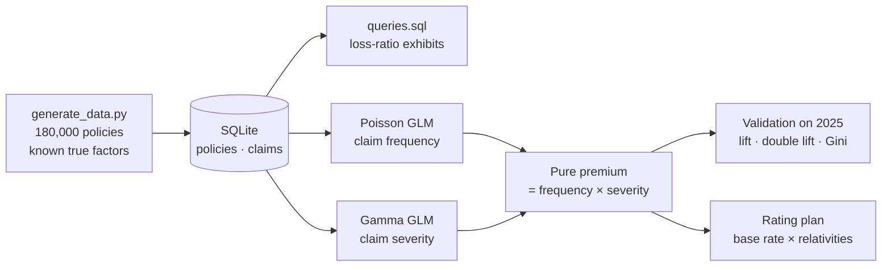
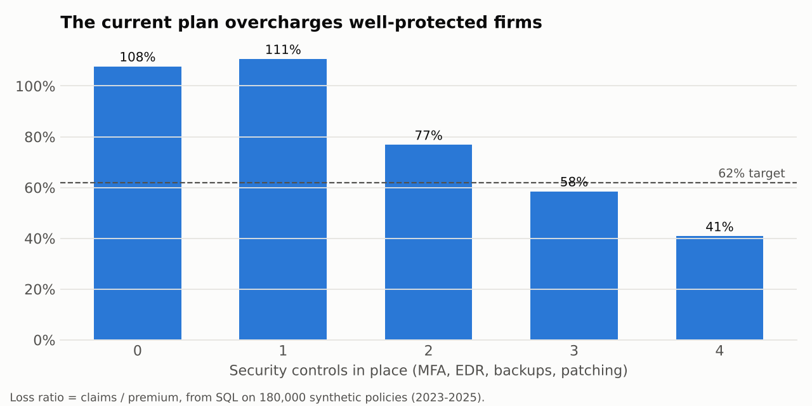
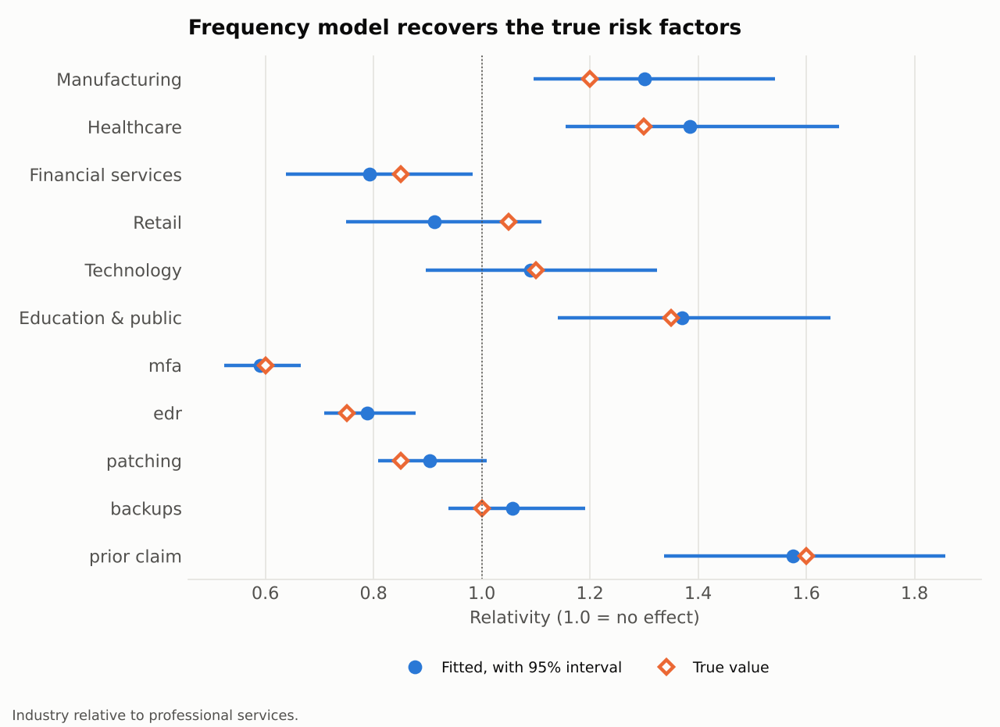
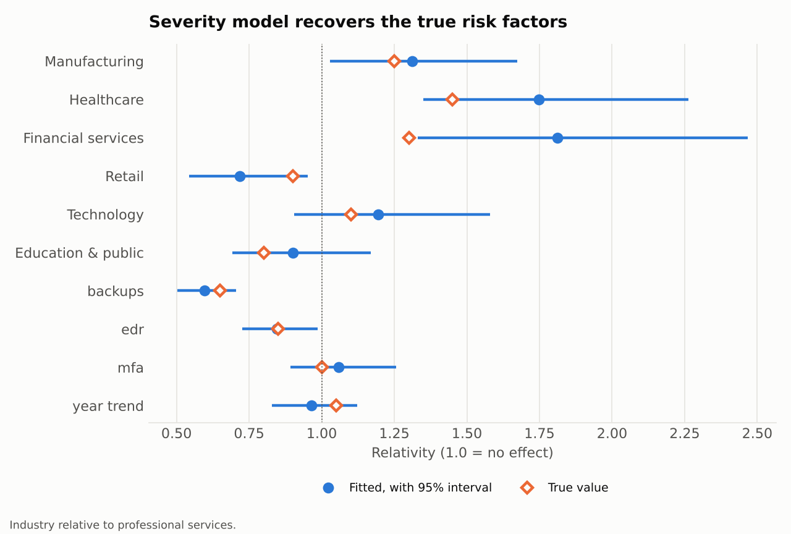
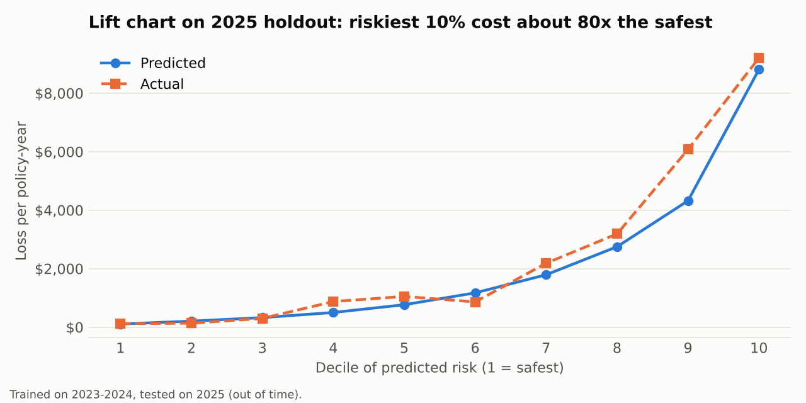
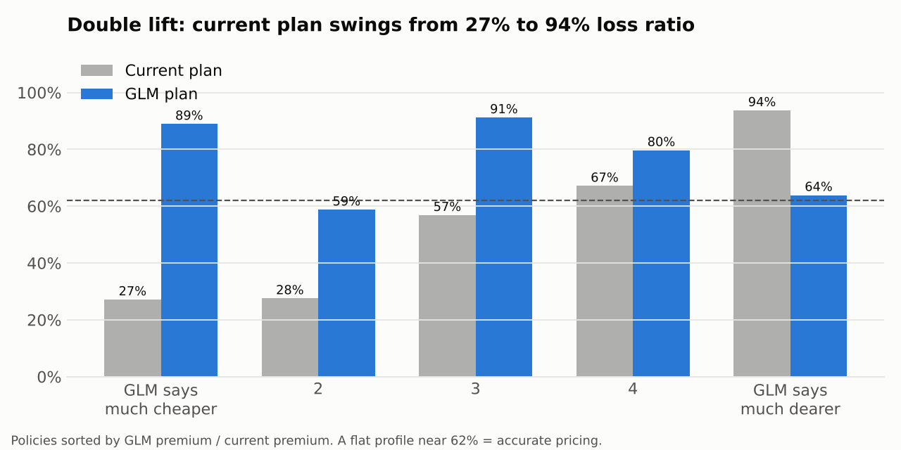

<div align="center">

# Cyber Pricing: Frequency-Severity GLM

**The current rating plan prices cyber on revenue and industry only. Should it give credit for security controls, and by how much?**


</div>

---

##  At a glance

| | |
|:--|:--|
| **Loss ratio, all 4 controls vs 0–1** | **41%** vs **108–111%** |
| **True risk factors recovered** | **22 of 23** inside 95% confidence intervals |
| **Indicated credits** | MFA **−37%**, EDR **−33%**, backups **−37%** |
| **Risk ranking on 2025 holdout (Gini)** | **0.60** vs 0.56 for the current plan |

> [!IMPORTANT]
> Firms with strong controls are being overcharged and firms without them undercharged. A multivariate GLM untangles control effects from company size and turns them into rating factors.

---

## Pipeline



Because the data is simulated from **known** risk factors, the model can be graded against the truth, which real data never allows.

---

## Results

### Step 1. SQL shows the problem


<details>
<summary>The SQL behind it (joins, CASE banding, window functions)</summary>

```sql
SELECT (p.mfa + p.edr + p.backups + p.patching) AS controls_in_place,
       COUNT(*) AS policies,
       ROUND(1.0 * COALESCE(SUM(c.n_claims), 0) / SUM(p.exposure), 4) AS frequency,
       ROUND(COALESCE(SUM(c.incurred), 0) / SUM(p.premium), 3)       AS loss_ratio
FROM policies p
LEFT JOIN (SELECT policy_id, COUNT(*) AS n_claims, SUM(amount) AS incurred
           FROM claims GROUP BY policy_id) c USING (policy_id)
GROUP BY controls_in_place;
```
</details>

> [!NOTE]
> **Confounding:** raw claim *frequency* barely moves with the number of controls (1.1%–1.3%), because larger firms have both more controls and more claims. Only a multivariate model separates the two.

### Step 2. The GLM recovers the true risk factors



### Step 3. It ranks risk well on unseen data



### Indicated rating plan
| Factor | Relativity | | Factor | Relativity |
|:--|--:|:-:|:--|--:|
| Has MFA | **0.63** | | Healthcare | 2.42 |
| Has EDR | **0.67** | | Manufacturing | 1.71 |
| Has tested backups | **0.63** | | Financial services | 1.44 |
| Has fast patching | 0.90 | | Technology | 1.30 |
| Prior claim | 1.58 | | Retail | 0.66 |

*Relativities are frequency × severity, relative to a professional-services firm with no controls.*

> [!WARNING]
> **Honest caveat:** the fitted severity trend (−4%/yr, wide interval) missed the true +5%, so the GLM's overall rate level runs about 14% light. In practice, trend comes from broader industry data and the overall level is set separately from the relativities.

---

##  Method details

**Frequency:** Poisson GLM with a log link and exposure offset

$$\log \mathbb{E}[N_i] = \log(\text{exposure}_i) + \beta_0 + \sum_k \beta_k x_{ik}$$

**Severity:** Gamma GLM with a log link on individual claims. **Pure premium** = frequency × severity, so relativities multiply: $e^{\beta_k^{freq}} \times e^{\beta_k^{sev}}$.

**Fitting:** `glm.py` implements iteratively reweighted least squares (IRLS) in NumPy, with standard errors and deviance. It matches scikit-learn's Poisson fit to within 3×10⁻⁶.

---

##  Files

```
02_cyber_pricing_glm/
├── generate_data.py      # synthetic book with known true relativities -> cyber_book.db
├── queries.sql           # loss-ratio exhibits
├── sql_analysis.py       # runs every query, saves CSVs
├── glm.py                # IRLS GLM engine (Poisson, Gamma, log link)
├── pricing_model.py      # fit, cross-check, validate, rating plan
├── figures/              # README charts
└── output/               # coefficient tables, exhibits, summary.json
```

```bash
python3 generate_data.py && python3 sql_analysis.py && python3 pricing_model.py   # ~5 seconds
```
