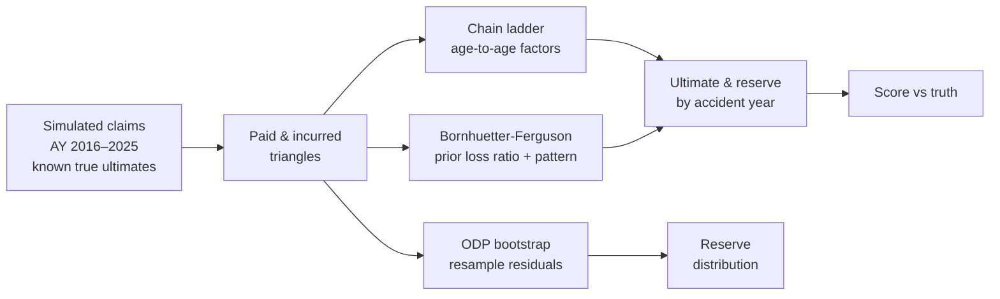
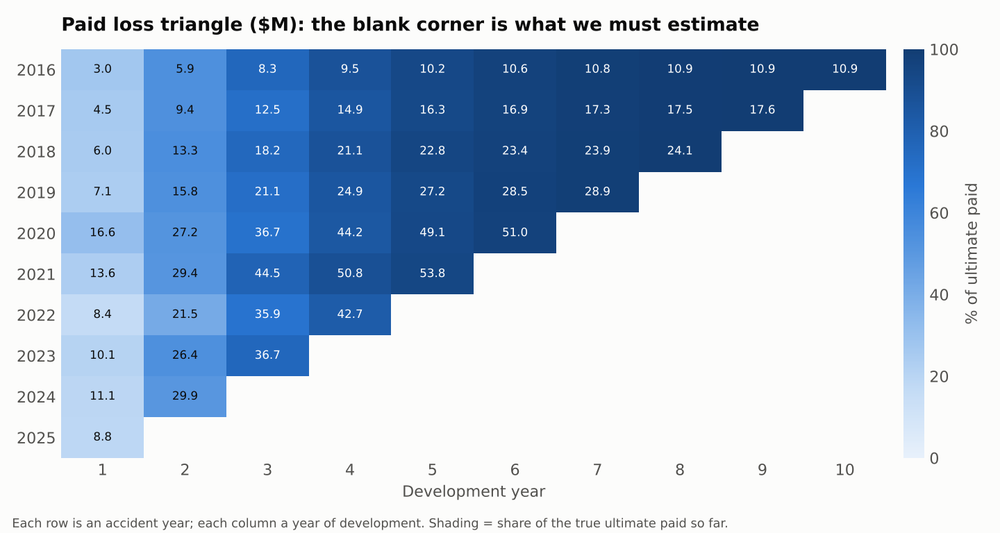
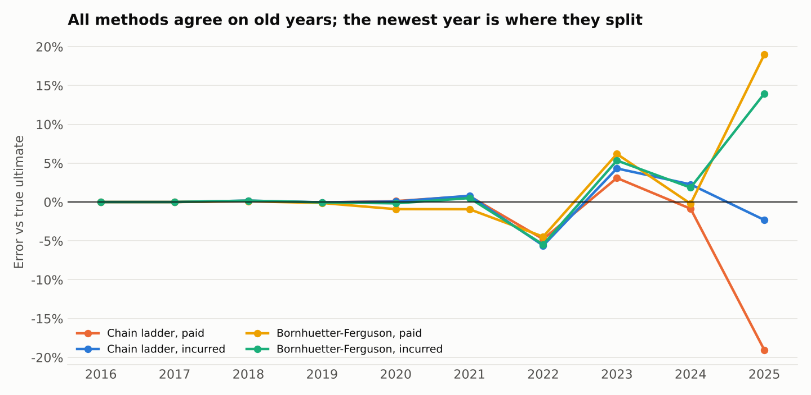
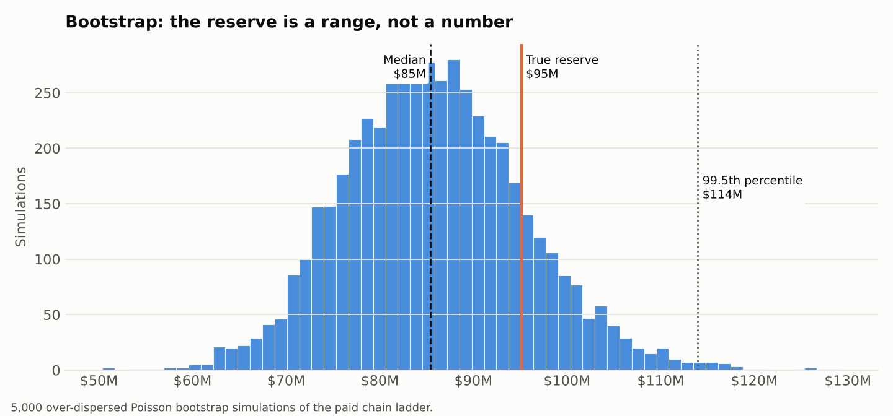

<div align="center">

# Cyber Loss Reserving

**How much does a fast-growing cyber book still owe on claims that have already happened, and how uncertain is that number?**


</div>

---

##  At a glance

| | |
|:--|:--|
| **True unpaid reserve** | **$95.1M** |
| **Best method (incurred chain ladder)** | **$95.1M**: within 0.1% |
| **Worst method (paid chain ladder)** | $85.1M: 11% short |
| **Bootstrap 99.5th percentile** | **$114M** |

> [!IMPORTANT]
> Every method agrees on old accident years. They split on the **newest** year, where little has been paid, so method choice is a judgment about which data to trust.

---

## How it works



The book grows from $20M to $100M of premium a year, with a **2020–2021 ransomware wave** that pushes loss ratios to 88–95%.

---

## Results

### The data: a paid loss triangle


### Which method gets closest?


| Method | Reserve | Error | Avg error, newest 3 years |
|:--|--:|--:|--:|
| Chain ladder, paid | $85.1M | −10.6% | 7.7% |
| **Chain ladder, incurred** | **$95.1M** | **−0.1%** | **3.0%** |
| Bornhuetter-Ferguson, paid | $103.7M | +9.0% | 8.5% |
| Bornhuetter-Ferguson, incurred | $102.8M | +8.1% | 7.1% |

### The reserve is a range, not a number


> [!TIP]
> **What each method teaches**
> - **Paid chain ladder** is unstable on immature years: one quiet year of payments put 2025 19% low.
> - **Bornhuetter-Ferguson** is stable, but inherits the pricing prior's bias: a 62% prior on years that ran lower made it 8–9% high.
> - **Incurred data** adds real information when case reserves are unbiased; check that with the claims team before relying on it.

---

## Method details

**Chain ladder.** Volume-weighted age-to-age factors, chained to ultimate:

$$f_j = \frac{\sum_i C_{i,j+1}}{\sum_i C_{i,j}}, \qquad \hat{U}_i = C_{i,\text{latest}} \times \prod_{j \ge \text{latest}} f_j$$

**Bornhuetter-Ferguson.** Blends the reported amount with an expected loss ratio for the unreported part:

$$\hat{U}_i = C_{i,\text{latest}} + \text{Premium}_i \times \text{ELR} \times \left(1 - \tfrac{1}{\text{CDF}_i}\right)$$

**ODP bootstrap (England & Verrall).** Resample scaled Pearson residuals of the incremental triangle, refit the chain ladder 5,000 times, and add gamma process variance.

---

## Files

```
03_cyber_loss_reserving/
├── reserving.py   # simulation, chain ladder, BF, bootstrap
├── figures/       # README charts
└── output/        # triangles, ultimates by method, summary.json
```

```bash
python3 reserving.py   # ~2 seconds
```

**Next:** Mack's analytic standard error and the Cape Cod method (both CAS Exam 5 material).
