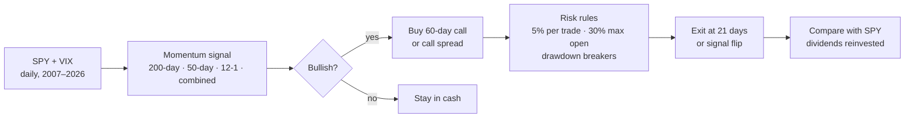
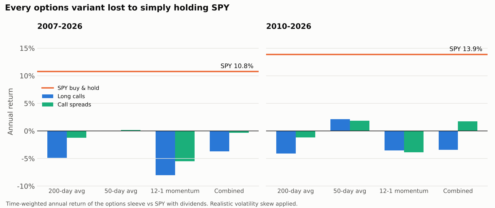

<div align="center">

# 📉 Systematic Options Strategy Backtester

**Can a rules-based momentum strategy that buys SPY call options beat simply holding SPY under strict risk limits?**


</div>

---

## 📌 At a glance

| | |
|:--|:--|
| **Variants tested** | 4 signals × 2 structures × 2 periods |
| **Best variant** | **2.1%/yr** (vs **13.9%** for SPY since 2010) |
| **Worst drawdowns** | 57–80% (vs 34% for SPY since 2010) |
| **Key lesson** | Found a pricing bias that faked a 2–3 point edge |

> [!IMPORTANT]
> **No variant beat buy-and-hold.** The first version *appeared* to show call spreads winning by 2–3 points a year. That came from pricing the sold call at the same volatility as the bought one. Adding realistic volatility skew erased the edge. Checking a too-good result is the real skill this project shows.

---

## 🧭 How it works



---

## 📈 Results



| Signal | 2007–2026 | 2010–2026 |
|:--|--:|--:|
| 200-day moving average | −1.2% | −1.2% |
| 50-day moving average | 0.2% | 2.1% |
| 12-1 month momentum | −5.5% | −3.5% |
| Combined | −0.3% | 1.7% |
| **SPY buy & hold** | **10.8%** | **13.9%** |

*Annual return of the better structure (calls or spreads) for each signal.*

> [!TIP]
> **Lessons**
> 1. Buying options repeatedly pays time decay and the implied-volatility premium every cycle; momentum timing doesn't earn it back.
> 2. Model both legs of a spread carefully: flat volatility across strikes overstated spread returns by 2–3 points a year.
> 3. Contract size interacts with position sizing: one at-the-money SPY call costs about $1,700–2,300, so a 5% rule needs a $33k+ sleeve.

**Follow-up:** the same signal applied to shares instead of options works as risk control. See [project 05](../05_trend_following/).

---

## 🔬 Method details

- **Pricing:** Black-Scholes with VIX as at-the-money implied volatility plus a log-moneyness skew, $\sigma(K) = \sigma_{ATM}\,(1 - 2.5\ln(K/S))$
- **Costs:** 3% of option price lost to bid/ask each way, plus $0.65 a contract
- **Risk rules:** 5% of the sleeve per trade, 30% maximum open premium, size halved at a 25% drawdown, trading paused at 40%
- **Benchmark:** the same contributions into SPY with dividends reinvested

---

## 📁 Files

```
04_spy_options_backtester/
├── spy_momentum_backtest.py   # backtester (downloads SPY and VIX via yfinance)
├── figures/                   # README chart
└── output/                    # compare_2007.csv, compare_2010.csv
```

```bash
pip install yfinance pandas numpy scipy matplotlib
python3 spy_momentum_backtest.py --compare
python3 spy_momentum_backtest.py --compare --start 2010-01-01
```
