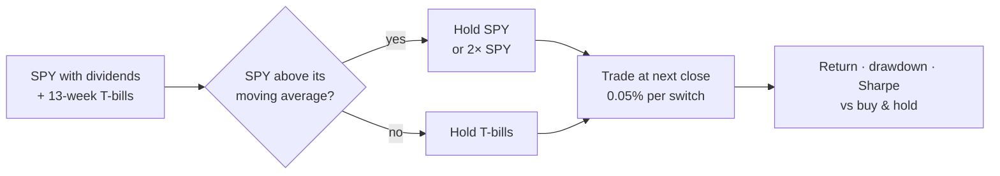
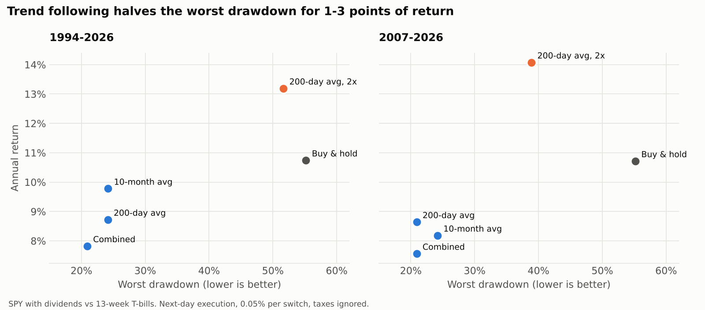
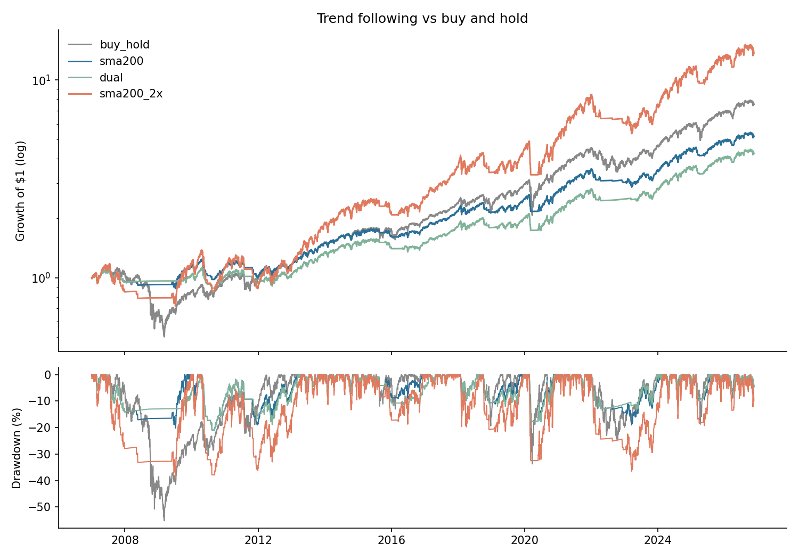

<div align="center">

# 🧭 Trend Following with Shares

**The momentum signal failed with options (project 04). Does it work when you hold SPY shares and step aside into T-bills?**


</div>

---

## 📌 At a glance

| | |
|:--|:--|
| **Worst drawdown** | **55% → 21–24%** |
| **Cost in annual return** | **1–3 points** below buy-and-hold |
| **Risk-adjusted return (Sharpe)** | Similar or slightly better |
| **2× version** | **13–14%/yr**, beating buy-and-hold's 10.7% |

> [!IMPORTANT]
> **Same signal, opposite verdict.** With options, momentum timing lost about 10 points a year. With shares, it cost only 1–3 points while cutting the worst loss by more than half. The instrument mattered more than the signal.

---

## 🧭 How it works



| Variant | Rule |
|:--|:--|
| `buy_hold` | Always in SPY: the benchmark |
| `sma200` | SPY above its 200-day average → SPY, else T-bills |
| `sma10m` | Month-end check against the 10-month average; far fewer trades |
| `dual` | 200-day average and 12-1 month momentum must both agree |
| `sma200_2x` | `sma200` with simulated 2× exposure (borrowing at the T-bill rate + 0.9%/yr fee) |

---

## 📈 Results

### Return vs worst drawdown


### Growth of $1 since 2007


| Strategy | Return 1994– | Return 2007– | Worst drawdown | Sharpe 1994– / 2007– | Trades/yr |
|:--|--:|--:|--:|--:|--:|
| Buy & hold | 10.7% | 10.7% | 55% | 0.51 / 0.54 | 0 |
| 200-day average | 8.7% | 8.6% | 21–24% | 0.55 / 0.63 | 6 |
| 10-month average | 9.8% | 8.2% | 24% | 0.60 / 0.56 | 1–2 |
| Combined | 7.8% | 7.6% | 21% | 0.49 / 0.56 | 7 |
| 200-day, 2× | **13.2%** | **14.1%** | 52% / 39% | 0.53 / 0.61 | 6 |

> [!TIP]
> **Lessons**
> 1. Trend following is a **drawdown-control tool**, not a return enhancer. Judge it on worst loss and Sharpe, not return alone.
> 2. **Leverage plus a trend filter** beat buy-and-hold because it stepped aside in 2008 and 2022. Real 2× funds have tracking error and decay in choppy markets.
> 3. **Taxes decide the version.** The 200-day rule's ~6 trades a year create short-term gains; the 10-month rule trades 1–2 times and keeps most of the benefit.

---

## 🔬 Honesty rules built in
- The signal uses today's close; the position changes at **tomorrow's** close (no look-ahead)
- 0.05% cost per switch; T-bills earn the 13-week Treasury rate
- Taxes ignored, so results flatter frequent-switching variants in taxable accounts

## 📁 Files

```
05_trend_following/
├── trend_following.py   # backtest (downloads SPY and ^IRX via yfinance)
├── figures/             # README chart
└── output/              # stats CSVs and growth charts for 1994– and 2007–
```

```bash
pip install yfinance pandas numpy matplotlib
python3 trend_following.py
python3 trend_following.py --start 2007-01-01
```
