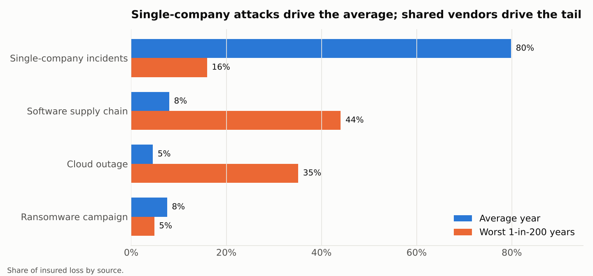
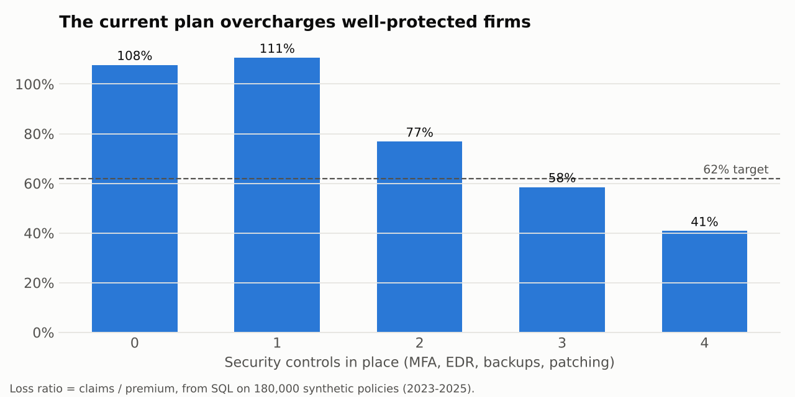
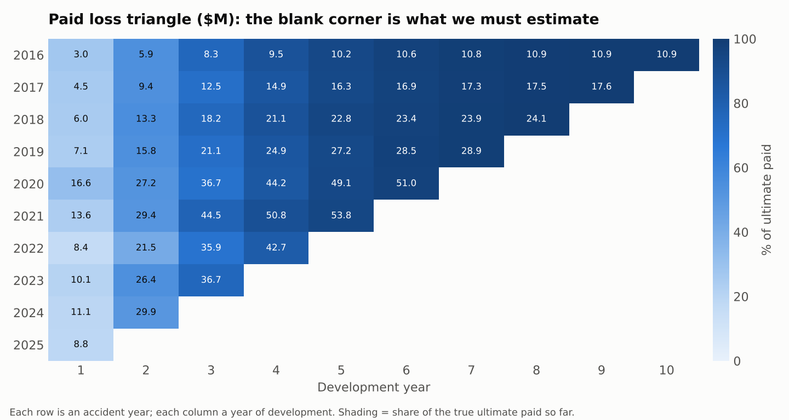
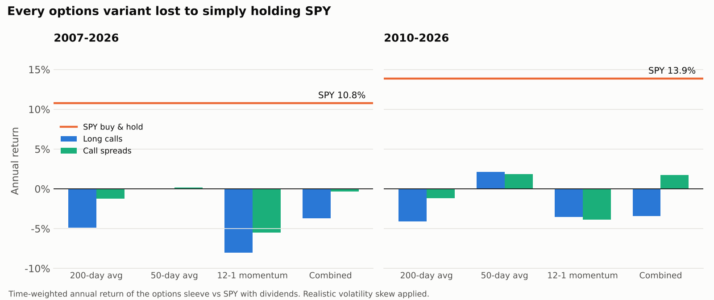
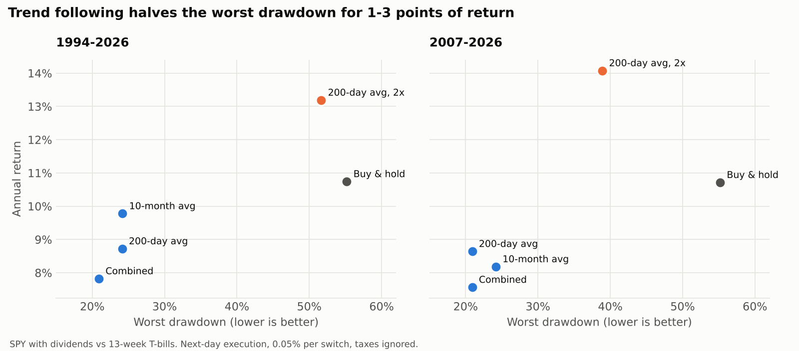
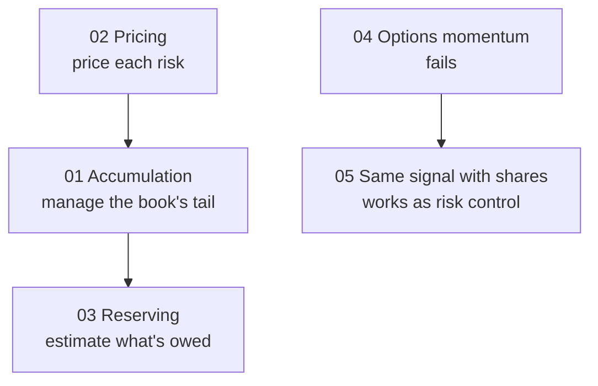

# John Szalko · Cyber Risk in Insurance/Options

**Industry focused, as well as what I am working on. A view on the weight of variables when assesing risk in the cyber market**
**pricing · catastrophe accumulation · reserving · systematic trading**

---

##  Projects

<table>
<tr>
<td width="50%" valign="top">

### [ Cyber Accumulation Model](01_cyber_accumulation_model/)

1-in-200 loss of **$112M** (2.6× premium); **~80%** of the tail comes from shared vendors. Reinsurance cuts capital **$82M → $37M**.

`Monte Carlo` `exceedance curves` `TVaR` `reinsurance` `capital` `unit tests`

</td>
<td width="50%" valign="top">

### [ Cyber Pricing GLM](02_cyber_pricing_glm/)

Recovers **22 of 23** true risk factors; MFA, EDR and backups each worth a **~35%** credit; Gini **0.60** vs 0.56.

`SQL` `Poisson & Gamma GLMs from scratch` `out-of-time validation` `lift charts`

</td>
</tr>
<tr>
<td width="50%" valign="top">

### [Cyber Loss Reserving](03_cyber_loss_reserving/)

Incurred chain ladder within **0.1%** of the true $95M reserve; bootstrap 99.5th percentile **$114M**.

`chain ladder` `Bornhuetter-Ferguson` `ODP bootstrap`

</td>
<td width="50%" valign="top">

### [Options Strategy Backtester](04_spy_options_backtester/)

No variant beat SPY (best **2.1%/yr** vs **13.9%**); found and fixed a pricing bias that faked a 2–3 point edge.

`Black-Scholes` `volatility skew` `risk controls` `19 years of data`

</td>
</tr>
<tr>
<td width="50%" valign="top">

### [Trend Following with Shares](05_trend_following/)

Same signal as 04, now with shares: worst drawdown **55% → 21–24%** for 1–3 points of return; the 2× version returned **13–14%/yr**.

`no look-ahead` `transaction costs` `leverage` `Sharpe`

</td>
<td width="50%" valign="top">

### How they connect

Projects 01–03 follow a lifecycle format of cyber risk in insurance formats. This includes exposures that are essential for pricing risk, and the weight that each variable holds historically. This blends to claims activity, which influences weight on the back end, whether short, or long tail risk. The theme across them: **controls separate good from bad individual risks, but the portfolio's tail comes from shared dependencies**, so it is managed with limits, wording, reinsurance and capital.

</td>
</tr>
</table>

---

##  Skills shown

| **Statistics & econometrics** | GLMs, Monte Carlo, bootstrap, out-of-time validation |

| **Actuarial methods** | Exceedance curves, PML, TVaR · rating plans · chain ladder, BF |

| **Risk & capital** | Reinsurance structuring and 99.5% VaR capital · drawdown controls |

| **Coding** | Python, NumPy, pandas, SQL, unit tests, reproducible one-command runs |

| **Judgment** | Calibration to public data, Quantitative Analysis, Discernment of Overfitting and Unfeasible outcome (TOO-GOOD) |

---

> [!NOTE]
> **Data:** no employer, client or proprietary data is used anywhere. Insurance data is simulated from documented assumptions calibrated loosely to public claims studies (Coalition 2026, NetDiligence 2025). Market data in 04–05 comes from Yahoo Finance at run time.

---

MIT License · Built in Python · Questions or feedback welcome via GitHub issues

